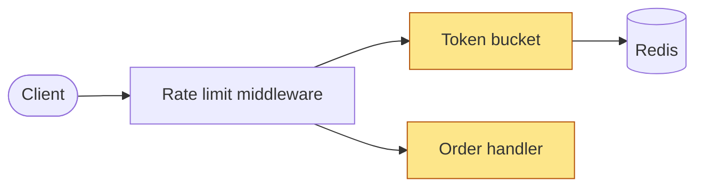

# Walkthrough

Explain a change step by step, in the order the code **runs**, not the order of the diff: an overview diagram and step map, then **one step per message** from entry to exit, then a recap. The goal is understanding the flow and the decisions behind it. This is not a code review: no findings, bugs or style notes, and no grading of the user.

**Short choices** end the message as a numbered plain-text list, after the content; then stop. The user replies with a number or in their own words. Every message here carries content above its choice, so it all stays in the message text: a question-tool popup can hide the text before it.

## 1. Gather silently

Scope, in this order:
- **A PR** (number or URL): run `gh pr view <n>` for the description **and**, separately, `gh pr view <n> --comments` (it omits the description). Then `gh pr diff <n>` and the full changed files at the head (`git fetch origin pull/<n>/head`, then `git show <sha>:<path>`). The PR need not be checked out.
- **A topic or file** ("the request flow"): if nothing in this session or branch touched it, walk through the **code as-is** (section 7) without asking. If changes touch it, ask: the changes or the code as-is?
- **Otherwise** this session's work, or the branch: base is `git merge-base HEAD main`, else `master`, else `origin/HEAD`; then `git diff <base>..HEAD`. If the branch has an open PR (`gh pr view --json number`), treat it as that PR.

Then **read beyond the diff**. Follow the flow outward until you reach the entry point(s) and the exit(s): callers of changed functions, interfaces they implement, config and defaults they rely on, consumers of anything they publish or enqueue. Unchanged code that links the changed parts belongs in the walkthrough.

**Why** comes only from sources: this session's rejected alternatives, the PR description and comments, why-comments, ADRs, linked issues. Credit the source in the step ("PR description: …"). For anything else, write **"my read:"**. Never present your guess as the author's reasoning.

## 2. Find the flow

- Entry points: HTTP handler or middleware, CLI command, scheduled job, message consumer, UI event, migration run. Step 1 of a track is the first code that handles the input (e.g. the middleware). Startup wiring in `main` is never step 1: show its changed lines in the step of the part it builds.
- Order steps by execution: entry → processing → exit (response, write, published event). Async: producer → queue → consumer → side effect, even across processes.
- **Tracks** follow entry points, not topics. One runtime path (request → limiter → handler → queue → consumer → store) is one track, even when it changes for several reasons. A new command, job or endpoint with its own entry point is its own track. Two or more: every track gets its own steps, under a `Track A · …` / `Track B · …` line in the map, each in execution order.
- Config, wiring, schema migrations, feature flags: in the step of the code that first uses them (a migration goes with the code that writes the column). Never a step of their own.
- Tests: one "How this is proven" step near the end. Mechanical changes (version bump, renames, formatting, lock files): one final "Other changes" step, or the recap's **Not covered** list.
- Every changed file is in a step or in **Not covered**. Never drop one silently.
- Aim for 4–10 steps. **Trivial change** (typo, one-line doc, rename): say it is trivial and offer a one-message summary instead of a walkthrough (**Summary** / **Walkthrough anyway**). Stop.

## 3. Check claims before they go in a step

A claim about behavior outside the changed code needs a source you read now: library defaults at the version pinned in the lock file, chart values, API specs, framework behavior. When the change builds a client and leaves options unset, those defaults *are* its behavior: before the overview, read them in the library source at the pinned version (module cache, vendor dir, or the tag upstream) and put them in that client's step. Memory is not a source. Name the source in the step ("HTTP client v2.3.1 `options.go`: retries 3"). Can't read it: drop the claim, or write "(unchecked)" next to it. The same holds for answers during **Dig deeper**.

## 4. Open with the overview

One message, in this order, then stop:
1. **Also read:** one line naming the unchanged code you read beyond the diff (e.g. "Also read: the middleware that calls the limiter, the queue consumer").
2. **Diagram:** a Mermaid `flowchart` (or `sequenceDiagram` when call order between a few parties is the point), at most ~10 nodes. Mark changed parts with `classDef changed`. Never put `;` in a label.
3. **Step map**, exactly in this form.
4. The short choice **Start**.



```
WALKTHROUGH · rate limiter

Track A · POST /orders
 ▶  1. Request enters the middleware      entry
 ○  2. Take a token from the bucket       changed
 ○  3. Counters in Redis                  context
 ○  4. Reject with 429                    exit
Track B · admin reset-limits
 ○  5. Reset one client's bucket          entry

 ○  6. How this is proven                 tests

 ✓ seen   ▶ now   ○ to come
 then: recap → parked questions → quiz-me
```

Right-column kinds: `entry`, `changed`, `context` (unchanged code needed to follow the flow), `logic`, `exit`, `tests`. Changed files you plan to leave out of the steps go on a `not covered:` line under the map.

## 5. One step per message

````
**Step 2 of 6 · Take a token from the bucket**
Flow: Client → Middleware → **Token bucket** → Redis

`limiter/bucket.go:40-52` · changed
```diff
 func (b *Bucket) Take(ctx context.Context, key string) (bool, error) {
+	n, err := b.store.Decr(ctx, key)
+	if err != nil {
+		return true, err   ◀ fails open
+	}
```

**What happens:** 1–3 sentences.
**Why:** 1–3 sentences, with the source, or "my read: …".

1. **Next step**
2. **Dig deeper**
3. **Park it**
4. **Skip to recap**
````

- Changed code: a `diff` block from the PR diff. Unchanged code: a plain fenced block with the language, headed `path:line · context`.
- About 15 lines per excerpt at most. Elide with `…`. Mark the line that matters with `◀`.
- No step map in a step; the `Flow:` breadcrumb shows the position.
- End with the short choice, then stop. Never start the next step in the same message:
  - **Next step**
  - **Dig deeper** — free back-and-forth on this step. Answer only; no next step until the user asks.
  - **Park it** — note the question. Say it is parked; answer it after the recap, not now.
  - **Skip to recap**

A question mid-walkthrough ("where is this called from?") is a dig deeper: answer it, and if the answer belongs in the flow, add a step to the map and say so.

## 6. Recap, parked questions, hand-off

1. The step map: seen steps `✓`, skipped ones left `○`.
2. **The flow** in 3–5 lines.
3. **Key decisions:** 2–4, each with its source or "my read".
4. **Not covered:** changed files not in any step, if any.
5. **Parked:** answer each parked question now.
6. The short choice: **Run `quiz-me` now (recommended)** on the same scope (it reads this walkthrough from the conversation), or **Done**.

## 7. Code as-is

For a flow nobody changed: same sections, with these differences.
- No `changed` class in the diagram. Kinds are only `entry`, `logic`, `context`, `exit` (`tests` only if the tests explain the flow).
- The rule that every changed file is in a step or in **Not covered** does not apply.
- All code in plain fenced blocks with `path:line`. No `diff` blocks.
- The scope is the flow the user named. Say in the overview where the walkthrough stops (e.g. "stops at the in-memory store").
- **Why** comes from why-comments, docs, ADRs, and `git log` / `git blame` on the key lines. Else "my read".
